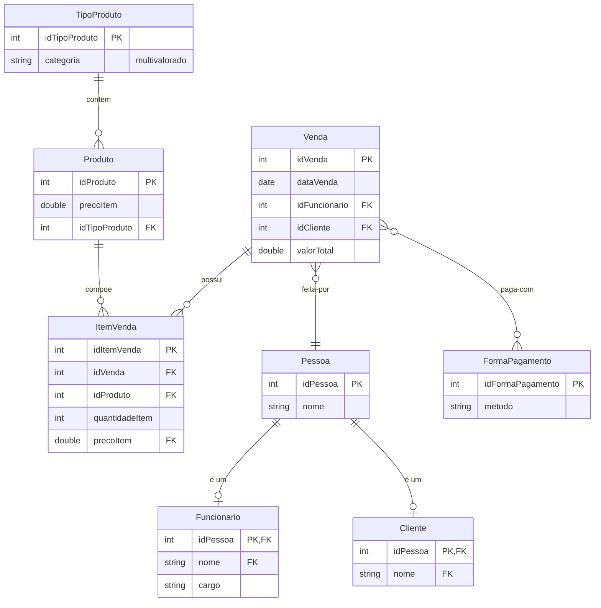

# Projeto Final de Banco de Dados

## 1. Objetivo
Construir e consultar um banco de dados relacional completo para o estoque de uma loja, aplicando todo o conteúdo da disciplina: modelagem (MER), modelo relacional, normalização, SQL (DDL, DML e consultas) e álgebra relacional.

## 2. Relatório
### 2.1. Descrição do negócio

(10 regras de negócio)

1. `Produto` deve ter sempre um `TipoProduto`
1. `ItemVenda` deve referenciar um `Produto` que foi vendido.
1. `Venda` deve ter pelo menos 1 `ItemVenda`
1. `Venda` é feita por um `Cliente` e executada por um `Funcionário`
1. `Venda` deve ter pelo menos 1 `FormaPagamento`
1. `TipoProduto` pode ter mais de uma `categoria`
1. `Produto` deve ter `precoItem` maior que 0.
1. `ItemVenda` deve registrar obrigatorimente a `quantidadeItem`
1. `Venda` deve possuir um `valorTotal` que é a soma de `preçoItem` de `ItemVenda`
1. `Funcionario` deve ter obragatoriamente um `cargo` válido.

### 2.2. Diagrama MER

## 3. Banco de dados

## 4. Scripts SQL
