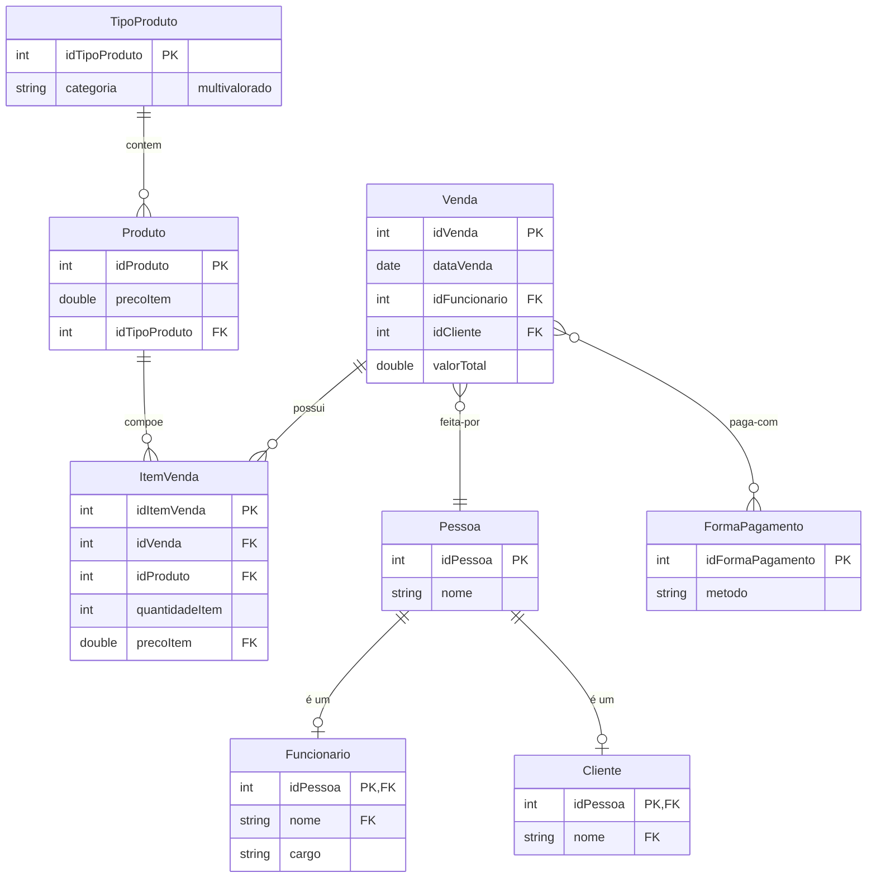

# Projeto Final de Banco de Dados

## 1. Objetivo
Construir e consultar um banco de dados relacional completo para o estoque de uma loja, aplicando todo o conteúdo da disciplina: modelagem (MER), modelo relacional, normalização, SQL (DDL, DML e consultas) e álgebra relacional.

## 2. Relatório
### 2.1. Descrição do negócio
O nosso negócio é o sistema de gerenciamento de um mercado em específico, nele nós cadastraremos cada produto, categorizando eles e os relacionando à vendas, que serão gravadas no nosso sistema. Também guardaremos os dados relacionados aos funcionários e clientes e suas relações com as vendas.

(10 regras de negócio)

1. `Produto` deve ter sempre um `TipoProduto`
1. `ItemVenda` deve referenciar um `Produto` que foi vendido.
1. `Venda` deve ter pelo menos 1 `ItemVenda`
1. `Venda` é feita por um `Cliente` e executada por um `Funcionário`
1. `Venda` deve ter pelo menos 1 `FormaPagamento`
1. `TipoProduto` pode ter mais de uma `categoria`
1. `Produto` deve ter `precoItem` maior que 0.
1. `ItemVenda` deve registrar obrigatorimente a `quantidadeItem`
1. `Venda` deve possuir um `valorTotal` que é a soma de `preçoItem` de `ItemVenda`
1. `Funcionario` deve ter obragatoriamente um `cargo` válido.

### 2.2. Diagrama MER

### 2.3 Dicionário das entidades

#### TipoProduto
Essa entidade é responsável por classificar todos os tipos de produtos.

- `idTipoProduto` é o identificador único de cada tipo de produto.

#### TipoProdutoCategoria
Essa entidade é responsável por classificar as categorias dos diferentes tipos de produtos.

- `idTipoProduto` é o identificador único de cada tipo de produto, que é uma chave estrangeira da entidade `TipoProduto`
- `categoria` é a categoria associada a cada produto, como: "Frios, carnes, vegetais, produtos de limpeza".

#### Produto
É cada produto individual do mercado.

- `idProduto` é o identificador único de cada produto.
- `precoItem` é o valor associado a cada produto que será vendido no mercado.
- `idTipoProduto` é o identificador único relacionado ao seu tipo, que é uma chave estrangeira da entidade `tipoProduto`

#### ItemVenda
É o(s) produto(s) relacionado(s) a cada venda, por exemplo 3 caixas de venda se encaixam no `ItemVenda`

- `idItemVenda` é o identificador único de cada conjunto de itens vendidos.
- `idVenda` é a chave estrangeira que está relacionada com a compra inteira realizada por alguém, ou seja, o "carrinho" completo. 
- `idProduto` é a chave estrangeira relacionada ao produto individual pertencente à entidade `Produto` 
- `quantidadeItem` é a quantidade de cada produto, por exemplo 7 cabos de vassouras.
- `precoItem` é o preço individual de cada item, que é uma chave estrangeira relacionada com a entidade `Produto`

#### Venda
É cada venda realizada, envolvendo todos os produtos selecionado e com o valor total da compra

- `idVenda` é o identificador único para cada venda realizada.
- `dataVenda` é a data na qual a venda foi realizada.
- `idFuncionario` é o identificador único relacionado ao funcionário que efetuou a venda, que é uma chave estrangeira de `Funcionario`
- `idCliente` é o identificador único relacionado ao cliente que fez a compra, que é uma chave estrangeira da entidade `Cliente`
- `valorTotal` é o valor total da venda realizada, ou seja, o preço total do carrinho do cliente

#### VendaPagamento
É a etapa de pagamento de cada venda

- `idVenda` é o identificador único de cada venda, que é uma chave estrangeira da entidade `Venda`
- `idFormaPagamento` é o identificador de cada formato de pagamento, que é uma chave estrangeira da entidade `FormaPagamento` 

#### FormaPagamento
É uma entidade que mostra os formatos de pagamento aceitos no mercado.

- `idFormaPagamento` é o identificador único de cada formato de pagamento.
- `metodo` é o método de pagamento, como: pix ou cartão de crédito.

#### Pessoa
É o registro de pessoas do mercado

- `idPessoa` é o identificador único de cada pessoa.
- `nome` é o nome de uma pessoa, que está atribuído ao seu id.

#### Funcionario
É o registro dos funcionários da loja

- `idPessoa` é uma chave estrangeira da entidade `Pessoa` e a chave primária para um funcionário.
- `nome` é o nome relacionado ao seu identificador, que é uma chave estrangeira da entidade `Pessoa`
- `cargo` é o cargo que o funcionário possui no mercado.

#### Cliente
É o cadastro dos clientes do mercado.

- `idPessoa` é uma chave estrangeira da entidade `Pessoa` e a chave primária para um cliente.
- `nome` é o nome relacionado ao seu identificador, que é uma chave estrangeira da entidade `Pessoa`

## 3. Banco de dados

## 4. Scripts SQL
- [DDL](01_ddl.sql)
- [DML](02_dml.sql)
