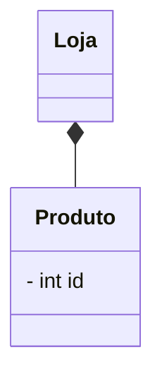

# Projeto Final de Banco de Dados

## 1. Objetivo
Construir e consultar um banco de dados relacional completo para o estoque de uma loja, aplicando todo o conteúdo da disciplina: modelagem (MER), modelo relacional, normalização, SQL (DDL, DML e consultas) e álgebra relacional.

## 2. Relatório
### 2.1. Descrição do negócio

(10 regras de negócio)

### 2.2. Diagrama MER

## 3. Banco de dados

## 4. Scripts SQL
